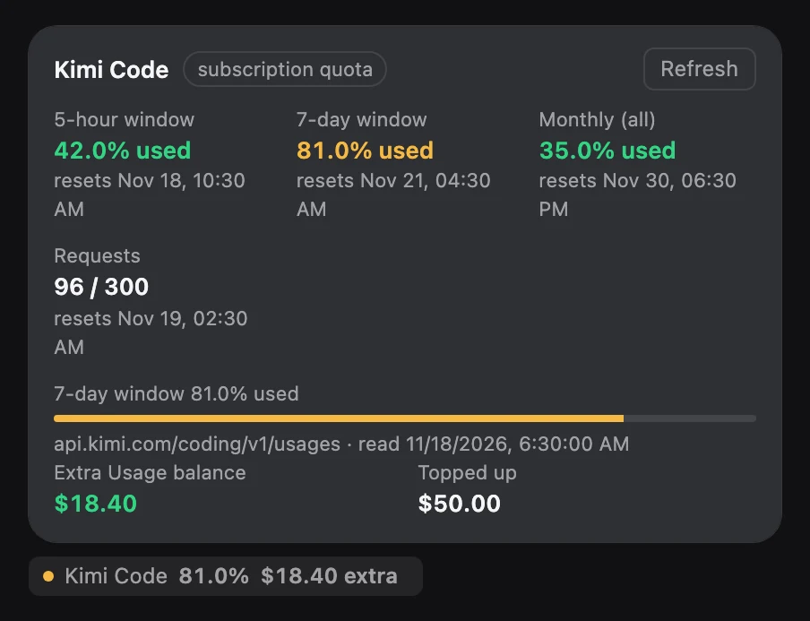
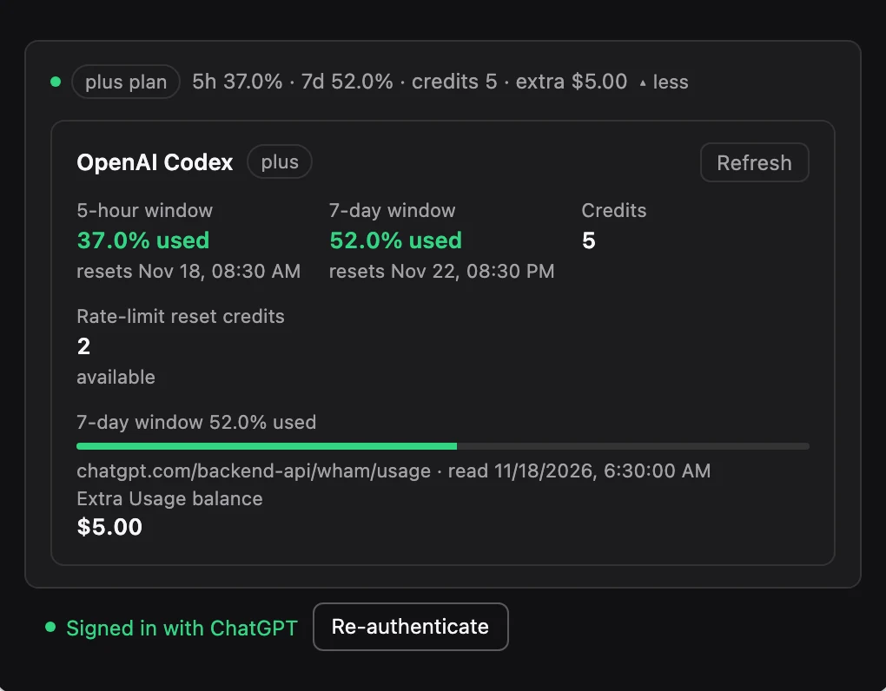
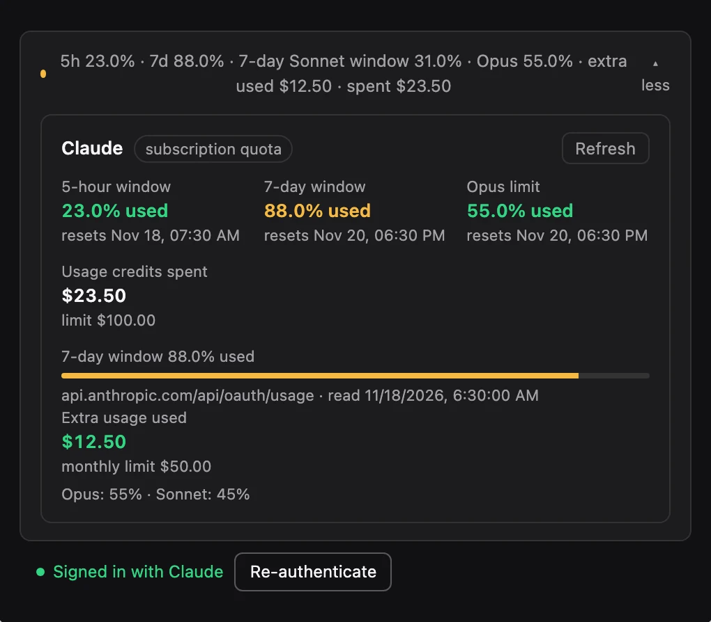

# DSH plugins

A collection of plugins for [DeepSeek Harness](https://github.com/deepseek-ai/deepseek-harness)
(DSH). Each package under `packages/` is installed on its own; see
[Packages](#packages) for the full list and each package's README for its
install steps, configuration and limits.

These are community plugins. They are not affiliated with, reviewed by or
endorsed by DeepSeek or the DeepSeek Harness maintainers, and they are provided
as is, without warranty (MIT).

The flagship package, **`dsh-plugin-provider-usage`**, shows provider balances
and subscription quota inside DSH. OpenRouter, Kimi Code, DeepSeek, GLM Coding
Plan, MiniMax Coding Plan, NewAPI, OpenAI Codex, and Anthropic Claude are
supported in one package. Its install steps follow.

## Install the usage plugin

### Desktop app

Open **Settings → Plugins → Add plugin → Install a third-party plugin**.
Enter `dsh-plugin-provider-usage`, install it, and enable it.

### Web or CLI

```sh
dsh plugin --profile web add dsh-plugin-provider-usage@latest
```

Replace `web` with your profile name when needed. Restart the Host and
refresh the page after installation.

> Registry installation requires the package to be published on npm. To try
> the source checkout before publication, use the development command below.

Read the [complete installation, configuration, and security guide](packages/usage/README.md).

## Preview

Usage appears inside configured provider cards. A composer chip follows the
active provider.

All five images below are rendered by the plugin's own client code, from its
test gallery, with sample data and an approximate dark theme. They show layout,
not real figures or exact colours, and only the plugin's own elements, not the
surrounding DSH page.


The chip images show the chip with its usage panel open above it, not the
surrounding composer:

| OpenRouter chip, panel open | Kimi Code chip, panel open |
|---|---|
|  |  |

Codex and Claude cards sign in with your plan through OAuth:

| OpenAI Codex | Claude |
|---|---|
|  |  |

## Packages

| Directory | npm package | Purpose |
|---|---|---|
| [`packages/usage`](packages/usage) | `dsh-plugin-provider-usage` | Provider-card usage, active-provider composer chips, `/usage-*` commands, and `/provider-login` OAuth sign-in for Codex and Claude |
| [`packages/ultracode`](packages/ultracode) | `dsh-plugin-ultracode` | Per-session exhaustive orchestration mode, a composer switch, and `/ultracode` |
| [`packages/advisor`](packages/advisor) | `dsh-plugin-advisor` | In-process read-only advisor (task plans and design/review advice) on a chosen model, a read-only evidence verifier, and `/advisor`; designed for the standard, ptc, cordis and minimal presets, supplying the lead's missing delegation tools while Advisor is on; minimal and long ptc reviews are covered by fake-host tests only, not by a live run |
| [`packages/router`](packages/router) | `dsh-plugin-router` | Lead-controlled model routing with three complexity-level shortlists and `/router` |
| [`packages/explainer`](packages/explainer) | `dsh-plugin-explainer` | Per-session output style that picks the lowest clear explanation form, with `/explain-style` and a model-options switch |
| [`packages/code-review`](packages/code-review) | `dsh-plugin-code-review` | Bounded code review with two independent finders and one refuter |
| [`packages/sessions`](packages/sessions) | `dsh-plugin-sessions` | Owner-only Sessions page: store sizes, archived sessions, and a reversible prune into a trash folder (macOS) |
| [`packages/model-discovery`](packages/model-discovery) | `dsh-plugin-model-discovery` | Scheduled, additive-only discovery of newly published pi-ai models, with `/model-discovery sync` and `status`, plus `/model-discovery seed` (preview, then confirm) to turn a provider without a `models` list into an explicit one and `/model-discovery local` to keep a self-hosted route in step with its own server |
| [`packages/session-search-patched`](packages/session-search-patched) | `dsh-plugin-session-search-patched` | Unofficial patched engine for the optional session search (bounded index; pinned to DSH 0.2.2-rc.3 and 0.2.2-rc.5, the shipped engine serves otherwise); install by folder path |

## Repository layout

- `packages/<name>/package.json` names one plugin; its Host entry is
  `src/index.host.js` and `cordis.patch.yml` declares the plugin row and defaults.
- Packages with a Web half ship a self-contained `src/client.js`
  (for example `packages/usage/src/client.js`).
- `packages/usage/src/providers/` contains one isolated module per provider
  (OpenRouter and Kimi also have a `*-defaults.js` file), plus the shared fetch
  layer (`net.js`) and the sign-in service (`login.js`).
- `docs/` holds the README images and the manual live checklists.
- Packages ship directly from `src/`. No build or copy step is required.

## Development

```sh
git clone https://github.com/anvilsong/dsh-plugins.git
cd dsh-plugins

# Install the shared test dependency once (the lockfile pins it):
npm ci

node --check packages/usage/src/index.host.js
node --check packages/usage/src/client.js

# Run every package's tests (tested with Node.js 24.22.3):
npm test

# Link one package from this checkout into a development profile:
dsh plugin --profile web add "$PWD/packages/usage"
```

Replace `web` with another development profile when needed. Use the Desktop
app's **Settings → Plugins** page for normal Desktop installations.

Reload the page after a client-only change. Restart the Host after a Host or
composition change.

Verifying client plugins: follow the [manual live menu checklist](docs/live-menu-checklist.md).

## License

Every package is [MIT licensed](LICENSE), and each package folder carries its
own copy.
