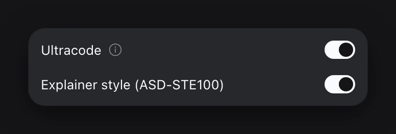

# dsh-plugin-explainer

A per-session output style for DeepSeek Harness that picks the lowest clear explanation form.

## What it does

`/explain-style on` adds a style rule of about 430 words to the system prompt for the current session. The plugin only adds this text: everything this README says the agent does is what the text asks, and nothing enforces it (see [Limits](#limits)). While the rule is on, a request to explain something, or to understand, compare or walk through it, is answered in the lowest form that serves:

1. **Short prose** for a definition, a procedure or a warning of about three paragraphs or fewer. Sentences stay within 20 words for procedures and 25 for descriptions, in active voice, with one instruction per sentence, one term per concept used the same way each time, no phrasal verbs or idioms, and a numbered list for steps. These limits apply to this form only.
2. **Text diagram** when the point is structure, flow, state, dependencies or sequence. The diagram uses plain text or box-drawing characters in the chat. Mermaid and SVG source is never pasted into the chat.
3. **One-file HTML page** for a topic with more than about five interacting parts, or one the user would want to explore or compare. The agent offers it in one line, and builds it without asking only when the user asked for a page, a visual or an interactive explanation. The page is one self-contained file with inline CSS and JavaScript, no build step and nothing loaded from the network. The agent writes it to `YYYY-MM-DD-<slug>/index.html` in the pages folder described below, never in the project repository. If it cannot write the file, it says so and explains in the chat. A page that should live inside the app, or that the user wants to keep or update, is not this form.

A video is never made on the agent's own initiative. If the user asks for one, the agent states the cost and confirms first.

The style applies to explanations only, not to code edits, tool output, status reports, plans, reviews or final reports. The style never makes an answer longer and overrides the page rules; rules that require a section in a status report or final report still apply.

## Where pages go

Pages go to a plugin-owned folder under the DSH home: `<DSH home>/explainer`, or the `dataDir` set in the plugin config. The prompt names the folder, and the agent writes each page into a new `YYYY-MM-DD-<slug>` folder there with its own file tools. The slug uses only lowercase letters, digits and hyphens. The agent never overwrites or deletes anything, touches nothing else under the DSH home, and never writes a page into the project repository. The prompt also tells the agent that writing and checking files inside this folder is allowed even where other rules say not to touch the DSH home, and that it must write the file itself, never handing the writing to another agent.

The agent confirms that the file exists and presents it to the user as a deliverable when the session lets it; otherwise it gives the absolute path and says the file is on the host machine. The agent does not open the page on the host machine unless the user asks.

The plugin only names the folder: it adds no tool and does no file work. Nothing deletes old pages: delete the folder by hand when you no longer need them. The plugin sets no permissions: the folder and its pages get whatever permissions the agent's file tools give them. They are not private (0700) like the data folders that some other plugins in this repository create.

With no usable folder (an invalid `dataDir`; or, without a `dataDir`, no DSH home or one that fails the same path rules) the prompt says that pages are unavailable, and the agent explains in the chat.

The wording is built by `policyFor(folder)` in [`src/index.host.js`](src/index.host.js). The exported `POLICY` constant holds the wording with the placeholder `<dataDir>` in place of the folder, and `PAGES_UNAVAILABLE_POLICY` holds the variant for no folder. Tests pin both exactly. The folder is decided once, when the plugin starts, by [`src/pages-dir.js`](src/pages-dir.js).

## Use

```text
/explain-style on
/explain-style off
/explain-style status
```

A call with no argument behaves like `status`. Arguments ignore case and surrounding spaces. Any other argument, such as `explainer`, returns `Usage: /explain-style on|off|status`. A repeated `on` or `off` succeeds and changes nothing. `status` reports `Explainer style: on.` or `Explainer style: off.`, or that an update is pending (`Explainer style is updating to on.`).

## The switch



*The picture is a redraw, not a capture: the rows, labels and spacing are the plugins' own styles and strings on DSH's dark theme tokens, and the switches are drawn approximately because DSH supplies them. The page that draws it is `docs/images/src/ultracode-explainer-switches.html` in the repository.*

The model-options menu of a conversation has an **Explainer style (ASD-STE100)** switch. Hover the row to see its tooltip: Plain explanations. Short prose follows ASD-STE100 writing rules (a subset); text diagrams and offered pages. The label names the standard the style is based on; it is not a claim of conformance. The style follows only a subset of ASD-STE100: sentence length limits (20 words for procedures, 25 for descriptions), active voice, one instruction per sentence, one term per concept, no phrasal verbs or idioms, and numbered steps. It applies them to short prose only, not to text diagrams or pages. It does not use the controlled vocabulary. The row shows no line of text under the label, so the menu keeps its size. The switch shows what the session has now, as the Ultracode and Router switches do. Pressing the switch runs `/explain-style on` or `/explain-style off`, the opposite of what the session shows, and it works from the keyboard like any button. While a change is pending the switch shows a spinner. A press during a pending change is ignored, not queued: the switch accepts a press again when the change finishes, after 30 seconds if the command itself never settles, or after five minutes if the session keeps showing the change as pending. If the command fails, the menu shows the error in its composer toast; without that channel the switch shows it inline. Until the session has a value, nothing is shown.

## Configuration

The bundle patch sets `dataDir` to `dshHomePath('explainer')`, which is `<DSH home>/explainer`. The default folder is shared by every profile, because the patch uses `dshHomePath`. To use another folder, set an absolute `dataDir` in the profile's own patch; a profile override replaces this whole config block. A profile's own patch can override `dataDir`, and a home-level `<DSH home>/cordis.patch.yml` applies after the profile patch. For example, add this row to `<DSH home>/profiles/<profile>/cordis.patch.yml`:

```yaml
- id: explainer
  config:
    dataDir: /absolute/path/to/pages
```

The folder is read when the plugin starts, so restart the host after you change it.

`dataDir` must be absolute, with no `..` segment, no control, bidirectional or invisible format character, no backtick, no surrounding whitespace, and it must not be a filesystem root or the DSH home itself. The path may be at most 512 characters. It must also be normalized, with no `.` segment and no doubled separator (such as `/a//b`); one trailing separator is allowed. On Windows it must name a drive or a UNC share. The checks look at the characters of the string only; the plugin reads no file system, so the folder need not exist yet and nothing is created.

The plugin cannot detect a folder inside the project repository or in another sensitive place; choosing `dataDir` is your responsibility. The prompt quotes the folder in backticks. The agent treats it as a path to write to.

An invalid `dataDir` is logged as a warning and turns pages off; it never falls back to another folder. Without a `dataDir` the plugin uses `<DSH home>/explainer` from the profile's DSH home, and without a DSH home too, pages are unavailable. The plugin reads no environment variable.

## Per-session behaviour

The setting is per session, and a new session starts off. It is derived from the session's `command/run` and `command/done` log entries: a successful `on` or `off` changes it, and a failed or rejected command leaves it unchanged. Resume recovers the same value from the log, without a settings file. While the style is off, the plugin adds no prompt text.

## What it does not do

- The plugin generates no files, runs no tools, and makes no model calls. The style only asks the agent to follow the rule; any page the agent writes is the agent's own work, and the plugin deletes none.
- It adds no tool and does not guard or change tool use.
- It does not make videos.
- The switch is a front end for the command: it adds no setting of its own and reads the session's value only.

## Requirements

- DeepSeek Harness with the Web GUI.
- The `@deepseek-ai/cordis` peer range in `package.json`.
- Loads and is active on DSH 0.2.2-rc.5; functional behaviour not re-verified on that release.

## Install

```sh
npm install
dsh plugin --profile <profile> add "$PWD/packages/explainer"
```

Run both from the repository root. `npm install` is needed once: it installs
`zod`, which the Host entry imports. Replace `<profile>` with your profile name;
a name that does not exist creates a new profile. Restart the host after installing
and refresh the page. The **Explainer style (ASD-STE100)** switch then appears in the model-options menu.
Then run `/explain-style status`: it should answer
`Explainer style: off.`

## Limits

- The rule is guidance in the prompt. The agent can still ignore it, and nothing checks its answers.
- A command sent while another update is pending is rejected until the pending one finishes or expires after five minutes.

## License

MIT, see [LICENSE](LICENSE).
