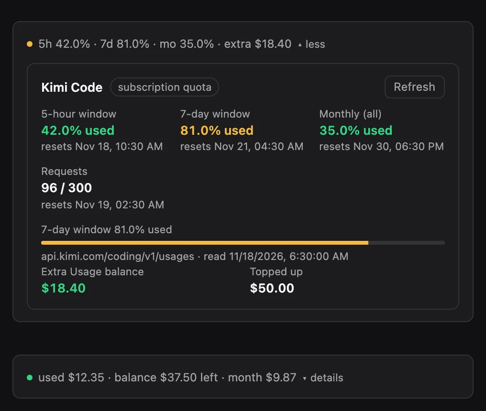
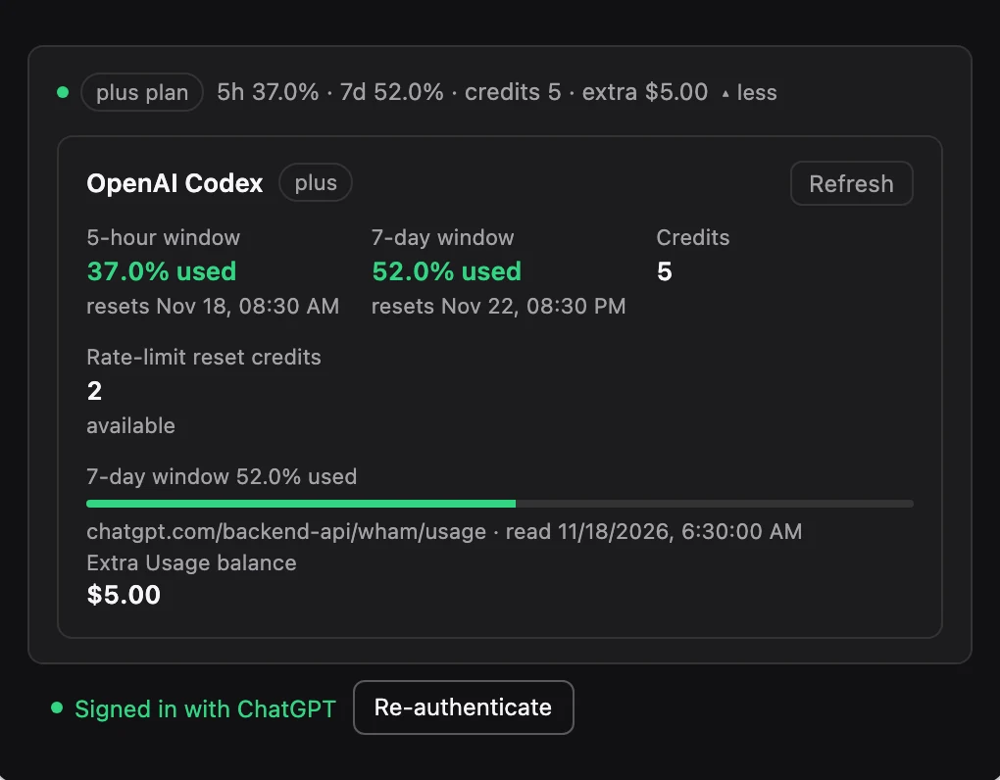
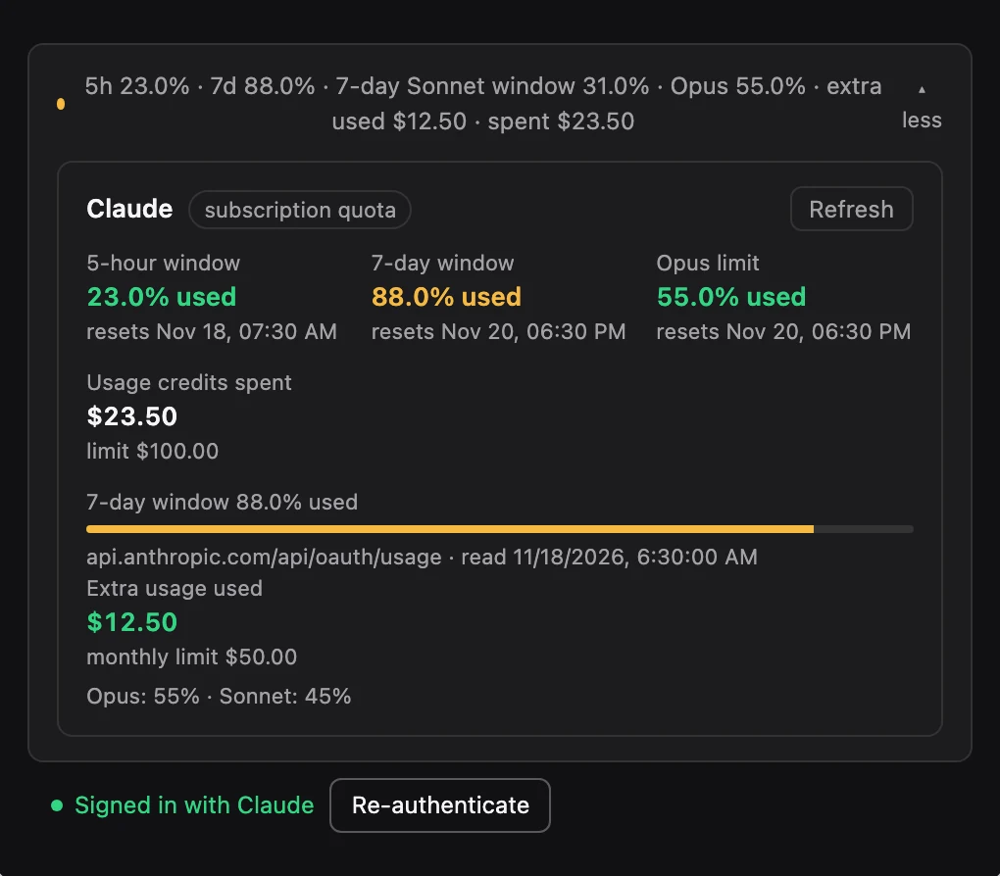
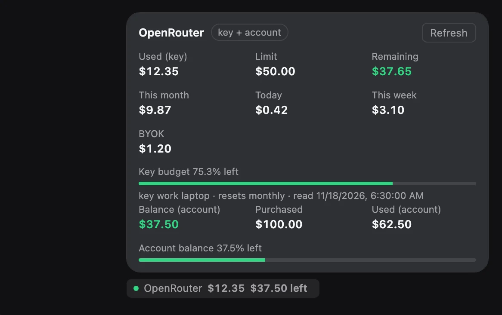
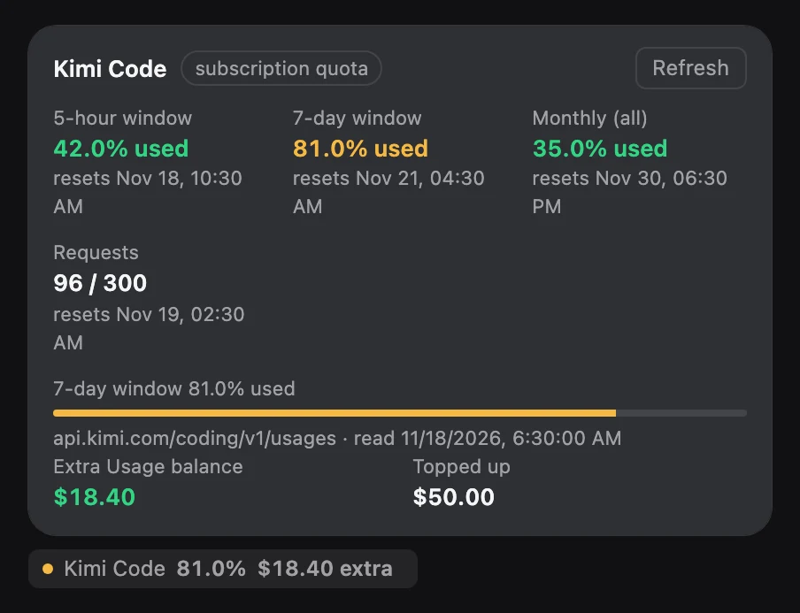

# dsh-plugin-provider-usage

[](https://www.npmjs.com/package/dsh-plugin-provider-usage)
[](https://github.com/anvilsong/dsh-plugins/blob/main/packages/usage/LICENSE)

Provider balances and subscription quota inside
[DeepSeek Harness](https://github.com/deepseek-ai/deepseek-harness).
One plugin supports OpenRouter, Kimi Code, DeepSeek, GLM Coding Plan,
MiniMax Coding Plan, NewAPI, OpenAI Codex, and Anthropic Claude.

Usage appears inside configured provider cards. A composer chip follows the
active provider. `/usage-*` commands print the same data in a session.
The plugin reads existing DSH credentials; it does not need a separate
account list.

## Images

All five images below are rendered by the plugin's own client code with
**sample data** and an approximate dark theme. They come from the HTML page
that the test gallery writes (`node packages/usage/test/helpers/gallery.mjs`,
in the source repository only). They show structure and layout, not your real
figures or exact colours, and they show only the plugin's own elements, not the
surrounding DSH page.

### Usage inside provider cards

Configured providers show a compact usage summary in **Settings → Models**.
Select **details** to expand the full panel without leaving the provider card.



The Codex and Claude cards sign in with your plan through OAuth and show plan
quota windows, credits and extra usage:

| OpenAI Codex | Claude |
|---|---|
|  |  |

### Composer chips

The chip follows the active provider. Select it to open the usage panel. The
images show the chip with its panel open above it, not the surrounding
composer.

| OpenRouter chip, panel open | Kimi Code chip, panel open |
|---|---|
|  |  |

## Install

An existing DeepSeek Harness installation is required.

> The registry commands below work after this package is published on npm.
> Before publication, install a source checkout with the command in
> [Development](#development).

### Desktop app

1. Open **Settings → Plugins → Add plugin**.
2. Choose **Install a third-party plugin**.
3. Enter `dsh-plugin-provider-usage` and install it.
4. Enable the plugin. Restart the app if DSH requests it.

The `desktop` profile is managed by the app. Do not modify its package files
by hand.

### Web or another CLI profile

```sh
dsh plugin --profile web add dsh-plugin-provider-usage@latest
```

Replace `web` with your profile name when needed. Restart `dsh web` and
refresh the page after installation.

### Upgrade or remove

Use the same **Settings → Plugins** page on Desktop. For a CLI profile:

```sh
dsh plugin --profile web update dsh-plugin-provider-usage
dsh plugin --profile web remove dsh-plugin-provider-usage
```

Restart the host and refresh the page after changing the installed version.

## Compatibility and verification

- The package declares a Cordis peer range of **`~4.1.0`**. On 2026-11-23 the
  DSH plugin manager listed it as loaded and active on DeepSeek Harness
  **0.2.2-rc.5** (Cordis 4.1.0).
- Plugin **0.7.0** (this release) was developed and tested against DeepSeek
  Harness **0.2.2-rc.5** with Cordis 4.1.0: the automated suite, the Web
  profile's Host and client halves, and a manual run of the composer chip, the
  provider cards and the sign-in blocks. The maintainer's earlier live check of
  OpenRouter and Kimi Code (plugin 0.3.0, DSH 0.2.1-rc.3, Cordis 4.0.5) predates
  the `~4.1.0` peer range and the shared request layer (same-origin redirects,
  1 MiB cap, redaction); those two providers have not been re-run on 0.2.2-rc.5,
  and no verification record is kept in this repository.
- The maintainer reports a live check of Codex and Claude sign-in and usage on
  an OAuth account. The date was not recorded, and no verification record is
  kept in this repository.
- Source development and the tests were run with Node.js **24.22.3** (the
  repository's `.nvmrc`). Other Node versions are not tested.
- The Web profile uses the same Host and Web APIs, but has not been verified
  separately.
- Older DSH versions are untested. The package declares its Cordis peer range
  so the host can reject an incompatible installation.

Provider verification is reported separately and honestly:

| Provider | Status |
|---|---|
| OpenRouter | Reported verified live by the maintainer in October 2026 (plugin 0.3.0, DSH 0.2.1-rc.3); not re-run on DSH 0.2.2-rc.5 or since the November 2026 request-layer change; no verification record in this repository |
| Kimi Code | Reported verified live by the maintainer in October 2026 (plugin 0.3.0, DSH 0.2.1-rc.3); not re-run on DSH 0.2.2-rc.5 or since the November 2026 request-layer change; no verification record in this repository |
| DeepSeek | Tested with stubbed replies modelled on the documented shape; not yet run with a live key |
| GLM Coding Plan | Tested with stubbed replies modelled on the documented shape; not yet run with a live key |
| MiniMax Coding Plan | Tested with stubbed replies modelled on the documented shape; not yet run with a live key. The plugin reads `*_remaining_percent` as 0–100; whether the API sends 0–1 fractions instead is unconfirmed |
| NewAPI | Tested with stubbed replies modelled on the documented shape; not yet run with a live key (needs a self-hosted site). A reply whose `code` is not the number 200 but carries a `message` is read as an error; the real type of `code` is unconfirmed |
| OpenAI Codex | Reported verified live against `/wham/usage` by the maintainer with an OAuth account; date not recorded; no verification record in this repository |
| Anthropic Claude | Reported verified live against `/api/oauth/usage` by the maintainer with an OAuth account; date not recorded; no verification record in this repository |

If a live reply differs from the parser,
[open an issue](https://github.com/anvilsong/dsh-plugins/issues).
Include the `/usage-<provider>` output, but remove all credentials and private
account data first.

## Provider login

OAuth login is built into this package. Use `/provider-login <provider>` or the
sign-in button on the Codex or Claude provider card. When signed in, the card
shows usage and a re-authentication action. The sign-in button appears when no
OAuth record exists, DSH offers OAuth for that row, and DSH reports no key for
it; a row with an API key or an environment credential shows no sign-in button.

```text
/provider-login openai-codex
/provider-login anthropic
```

The command runs OAuth only. It appends no message to the conversation: the
sign-in link, any code, and progress appear in a question in the composer area.
The host still records the command itself (`command/run` and `command/done`) in
the session log, and shows the command's one-line result
(`<provider>: authorized…`, or why the sign-in stopped) as the command's entry
in the conversation. When the provider asks for something, the link is shown
above that request in the same question. In the Claude and Codex browser flows the
wait happens inside the paste-code question: sign in in the browser, or paste
the code there. While the flow waits on the browser with nothing to ask, the
question offers only **Cancel sign-in**. Expand the question text if it is cut
off, then copy the link.

Where the provider asks for text (the pasted code), you type the answer into the
question's **Other** field. Everything else cancels the sign-in: **Cancel sign-in**,
**Skip**, closing the question, and, on a choice between options, text typed into
**Other** that names none of them. That text is never passed on or logged.
A question the host cannot show (no question UI, or a session that is not a root
conversation) ends the sign-in with that reason instead of "cancelled"; use the
provider card, or add the credential in **Settings → Models**.

API keys are entered in **Settings → Models**. `/provider-login <provider> api-key`
is refused, because a question cannot mask a typed key. For the same reason,
`/provider-login` cancels an OAuth flow that asks for a secret, or for anything
other than text or a choice. The sign-in button on the provider card does not
use a question: it shows the link, the code and any prompt inside the card, and
masks a secret prompt there.

## Providers

> **Codex and Claude use plan endpoints, not a documented API.** Their rows read
> `chatgpt.com/backend-api/wham/usage` and `api.anthropic.com/api/oauth/usage` with
> your OAuth sign-in token. This repository cannot point to a published, versioned
> contract for either endpoint, so they can change or stop working without notice,
> and the vendors' terms may govern this use: check them before you rely on it.

| Provider | Source | Shows | Command | Chip shows under |
|---|---|---|---|---|
| OpenRouter | `/api/v1/key` + `/api/v1/credits` | credits, key meters (day/week/month), BYOK, limits | `/usage-openrouter` | `openrouter` |
| Kimi Code | `GET {base}/usages` | quota windows, requests, Extra Usage wallet | `/usage-kimi` | `kimi-coding` |
| DeepSeek | `GET {base}/user/balance` | balance per currency (granted / topped up) | `/usage-deepseek` | `deepseek`, `deepseek-official` |
| GLM Coding Plan | `GET {base}/api/monitor/usage/quota/limit` | 5-hour and 7-day windows, tool-call counts, plan level | `/usage-zhipu` | `zai-coding-cn`, `zai` |
| MiniMax Coding Plan | `GET {base}/v1/api/openplatform/coding_plan/remains` | 5-hour and 7-day windows | `/usage-minimax` | `minimax-cn`, `minimax` |
| NewAPI | `GET {baseUrl}/api/usage/token` | token quota as USD (granted / used / remaining) | `/usage-newapi` | none by default — set `gate` in config |
| OpenAI Codex | `GET {baseUrl}/wham/usage` | plan, quota windows, credits, reset credits | `/usage-codex` | `openai-codex` |
| Anthropic Claude | `GET {baseUrl}/api/oauth/usage` | 5-hour and 7-day windows, model-scoped limits, extra usage, spend, breakdown | `/usage-anthropic` | `anthropic` |

Provider notes:

1. GLM's monitor API takes the raw key in `Authorization`, with no Bearer
   prefix.
2. MiniMax reports remaining percent. The plugin converts it to used percent.
3. NewAPI has no default site. It needs a `baseUrl`, and its section must not
   set `enabled: false` (the bundle default).
4. Kimi uses an honest User-Agent. The plugin does not imitate another CLI.
5. OpenRouter account-wide credits require a management key. Ordinary keys
   still provide per-key usage and limits.
6. Codex reads the OAuth credential stored by DSH. Sign in through the
   provider card or run `/provider-login openai-codex` first.
7. Claude usage reads the OAuth credential stored by DSH. Sign in through the
   provider card or run `/provider-login anthropic` first.
8. Codex and Claude usage send the stored access token as it is; the plugin
   never refreshes it. When the token has expired, the read fails until the
   stored sign-in is renewed. Signing in again from the card or with
   `/provider-login` stores a new one.
9. A NewAPI token with unlimited quota has no balance to read; it shows the
   `unlimited-quota` failure.

## Credentials and security

| Provider | Default credential reference |
|---|---|
| OpenRouter | `OPENROUTER_API_KEY` |
| Kimi Code | `KIMI_CODING_API_KEY` |
| DeepSeek | `DEEPSEEK_API_KEY` |
| GLM Coding Plan | `ZHIPU_API_KEY` |
| MiniMax Coding Plan | `MINIMAX_API_KEY` |
| NewAPI | `NEWAPI_API_KEY` |
| OpenAI Codex | `llm-pi-ai/openai-codex` (OAuth record) |
| Anthropic Claude | `llm-pi-ai/anthropic` (OAuth record) |

Configure model-provider keys in **Settings → Models**. For the API-key
providers the plugin also reads credentials that the DSH credentials service
resolves from its credential store or environment. Codex and Claude read only
the stored OAuth record.

Security properties:

1. The Host resolves a key only when it makes a request. The sign-in status
   check of the Codex and Claude cards reads only whether the OAuth record
   exists.
2. Raw keys stay in the Host process. Remote snapshots contain usage data,
   not credentials.
3. Keys go only to the configured provider endpoint. A custom `baseUrl`
   changes that destination, so use a site you trust.
4. Usage snapshots stay in memory. The plugin writes no usage history,
   account list, analytics, or telemetry to disk. DSH itself stores two
   things: a `/usage-*` report, like any command result, is saved in the
   session log, and a sign-in stores its OAuth record in the DSH credential
   store.

Every provider request follows the same outbound policy:

1. **Base URL.** A `baseUrl` must use `https`. Plain `http` is accepted only
   for `localhost`, `127.0.0.0/8` and `[::1]`, or when that provider's section
   sets `allowHttp: true`. With `allowHttp`, the Host log warns once at mount
   that the key travels unencrypted. A base URL with user info
   (`user:password@`), a query or a fragment is refused. A refused base URL
   leaves that provider unmounted, and the Host log has one warning that names
   the provider and the reason, never the user info or the query. OpenRouter
   has no `baseUrl`: its endpoints are fixed.
2. **Codex and Claude.** A `baseUrl` on another host than the default sends
   the OAuth sign-in token to that host. It works, and the Host log warns once
   at mount.
3. **Redirects.** A redirect to the same origin is followed at most 3 times,
   with the same headers. A redirect to another origin, a fourth redirect, or a
   redirect to an invalid target fails with `redirect-refused`; the failure
   text names only the target origin. The credential is never sent to another
   origin.
4. **Reply size.** A reply body larger than 1 MiB fails with `too-large`,
   whether its `Content-Length` says so or the body grows past 1 MiB while it
   is read. The request timeout covers the body read.
5. **Redaction.** The credential sent with a request is removed from every
   text value of the reply and from the request's failure texts before
   anything is stored. The key, its URL-encoded and JSON-escaped forms, and any
   `Bearer <token>` of 16 or more characters that the server quotes appear as
   `[redacted]` in the state, the panel, the `/usage-*` reports and the Host
   log. Values
   shorter than 8 characters are not redacted. A failure detail is one line of
   at most 300 characters. The endpoint in a state or a report is the origin
   and path only.

## Surfaces

| Surface | Behavior |
|---|---|
| Settings → Models provider card | A compact usage line inside each provider's own card; click expands the full panel. Hidden when DSH reports the row's key as not configured, unless the row is an OAuth row (Codex, Claude) with a stored sign-in; it also stays empty until the first read has produced data or a failure. NewAPI has no card line |
| Composer chip | Follows the session's active provider; click opens the panel in a popover above the chip (below it when there is no room), kept inside the window. Escape, a click outside, moving the focus to another element, or opening another chip closes it; Escape returns the focus to the chip unless the focus already moved elsewhere. One chip popover is open at a time |
| Commands | `/usage-<provider>` refreshes, then prints a text report |

Provider cards register by settings namespace and then match each row's
provider route against the plugin's built-in routes (the default gates in the
[Providers](#providers) table). This matters because all pi-ai rows share one
settings namespace. GLM covers `zai-coding-cn` and `zai`; MiniMax covers
`minimax-cn` and `minimax`. The `gate` config option does not change the
cards, so NewAPI, which has no built-in route, never gets a card line.

Each chip reads the active provider from the shared per-session model
directory. A blank session resolves the catalog default. An unknown provider
hides the chip. The Host config can override the chip's `gate` list for
DeepSeek, GLM, MiniMax, NewAPI, Codex and Claude; OpenRouter and Kimi ignore
`gate`. This is how a config-only provider such as NewAPI gets a chip.

## Stale, unavailable and offline reads

A refresh can fail: a missing credential, an HTTP error, a timeout. The Host
keeps the last good data, so every surface can show it and say how old it is.

| You see | It means |
|---|---|
| `stale · read <time>` next to the card line or in the panel footer; the chip keeps its values and adds the word `stale`; the dot is at least amber | The last refresh failed but an earlier read exists. `<time>` is the last good read. The stale mark and the failure stay while the next refresh runs |
| `Usage unavailable` on the card; `unavailable !` and a red dot on the chip | The last attempt failed and there is no good read yet. The card also shows the failure text |
| `Host not reachable: <message>`, with the last data (if any) marked stale | The Remote call failed for a reason other than a missing service, usually a lost connection to the Host. The Refresh button stays usable and the next good reply clears the note |
| `Usage is not available for this provider` and the Gateway's message in the secondary colour; no chip when nothing was read before | The Host has no usage service for this provider (its row is disabled, its base URL was refused, or its mount failed) while other providers still answer. This is not an error, so nothing is red. With no earlier read the chip is hidden even with `showComposerChip: true`; after a good read the chip keeps the last figures, marked `stale` |

The client tells the last two apart by the failure code, not by its text,
whether the Remote call answered `{ ok: false }` or was rejected:
`gateway/invocation-unavailable`, `gateway/service-unavailable`,
`gateway/method-unavailable` and `gateway/definition-unavailable` mean the
service is missing; any other code is a lost connection, and so is a failure
that carries no code.

The expanded panel shows two different times: `Refresh failed at <time>:
<detail>` is the time of the failed attempt and `read <time>` the last good
read. A Host that sends no attempt time shows `Refresh failed: <detail>`
without a time. A time from today prints as a time; a time from another day
also prints its date.

Text reports (`/usage-<provider>`) end with a footer, printed once:

```text
Last good read: <time>
Warning: last refresh failed at <time> (<code>): <detail>
```

`Last good read: never` stands for a provider with no good read. The warning
line appears only while the last attempt failed, and it ends after `(<code>)`
when there is no detail. A report with stale data is still a success and
carries the last numbers; with no data at all the command answers with an error
`<Provider> usage unavailable: <detail>`.

A command that arrives while a refresh is running joins it: one request serves
the poll, the Refresh button and the command, and each gets the result of that
refresh, never a half-finished state.

## Configuration

The defaults are enough for OpenRouter, Kimi Code, DeepSeek, GLM and MiniMax
once their keys are set, and for Codex and Claude after sign-in. NewAPI is
disabled until you configure its site.

To change defaults, override the plugin row by its bare id `usage` in
`~/.dsh/profiles/<profile>/cordis.patch.yml` (an `include:usage` id matches no
row, and DSH skips such a patch with an `entry … not found` warning):

```yaml
- id: usage
  name: dsh-plugin-provider-usage
  config:
    providers:
      openrouter:
        enabled: true
        credentialRef: OPENROUTER_API_KEY
        showAccount: true
        showComposerChip: true
      kimi:
        enabled: true
        credentialRef: KIMI_CODING_API_KEY
        region: cn
        refreshMs: 120000
        timeoutMs: 15000
        showComposerChip: true
      deepseek:
        enabled: true
        credentialRef: DEEPSEEK_API_KEY
        showComposerChip: true
      zhipu:
        enabled: true
        credentialRef: ZHIPU_API_KEY
        region: cn
        showComposerChip: true
      minimax:
        enabled: true
        credentialRef: MINIMAX_API_KEY
        region: cn
        showComposerChip: true
      newapi:
        enabled: false
        credentialRef: NEWAPI_API_KEY
        # baseUrl: https://your-newapi-host.example
        # gate: ['your-provider-route-id']
```

**Config is replaced as a whole.** Restate every option you changed. A
provider section you leave out falls back to the built-in defaults and stays
enabled (NewAPI stays off without a `baseUrl`); set `enabled: false` to turn a
provider off. Do not add a second `- insert:` row for this plugin.

To enable NewAPI, change its section to `enabled: true`, set `baseUrl`, and
make `NEWAPI_API_KEY` available to the DSH credentials service. Set `gate` to
the model-provider route under which its composer chip should appear. NewAPI
has no usage line on a provider card; use its chip or `/usage-newapi`.

| Option | Default | Meaning |
|---|---|---|
| `enabled` | `true`; NewAPI `false` | Mount or skip one provider without affecting the others |
| `credentialRef` | provider-specific | Credential reference resolved by DSH; for Codex and Claude, the key of the stored OAuth record |
| `showComposerChip` | `true` | Show or hide the composer chip |
| `refreshMs` | `120000` | Poll interval; clamped to 30 seconds–1 hour |
| `timeoutMs` | `15000` | Request timeout; clamped to 5–120 seconds |
| `gate` | provider-specific | Provider route ids under which the composer chip shows; ignored by OpenRouter and Kimi. Provider cards always use the built-in routes |
| `region` | `cn` | `cn` or `global` for Kimi, GLM, and MiniMax |
| `baseUrl` | provider default | API base override; required for NewAPI |
| `allowHttp` | `false` | Accept a plain `http` `baseUrl` on a non-loopback host, such as a LAN relay; only the boolean `true` counts |
| `endpoint` | `key` | OpenRouter primary endpoint: `key` or `credits` |
| `showAccount` | `true` | Also request OpenRouter account-wide credits |

One provider's mount or request failure does not disable its siblings.
Within one provider the three surfaces fail separately:

- If the Remote service cannot be provided, nothing else of that provider is
  mounted (no command, no poll) and the Host log names the provider.
- If the `/usage-<provider>` command cannot be registered (a duplicate name,
  say), that is logged once and the service and the poll stay mounted, so the
  card still refreshes.
- If the poll effect cannot start, the service and the command stay mounted
  but nothing polls; the Host log names the provider and the poll.
- The sign-in service and the `/provider-login` command are independent of each
  other and of the eight providers: a failure of one is logged and the others
  stay mounted.

The whole Host half needs the `credentials`, `commands`, `authorization` and
`userQuestions` services. On a host without any one of them, the plugin stays
pending and no provider mounts.

A failed refresh keeps the last good data and its read time (`fetchedAt`),
records the time of the attempt (`attemptedAt`), and keeps the error and its
detail while the next refresh runs. Any other failure inside a refresh ends in
an `unexpected` error state, never in a state stuck at `loading`.

## Troubleshooting

- **No usage line on a provider card:** the card is hidden when DSH reports
  that row's key as not configured, unless the row is Codex or Claude with a
  stored sign-in. It also stays empty until the first read has produced data
  or a failure. NewAPI never shows a card line; use its chip (with `gate`) or
  `/usage-newapi`.
- **`Usage is not available for this provider`:** the Host has no usage
  service for that row. Check that its `enabled` option is not `false` and look
  in the Host log for `usage: provider "<id>" failed to mount`,
  `usage: provider "<id>" refused its baseUrl` or
  `usage: provider "newapi" has no baseUrl`.
- **`Host not reachable: <message>`:** the Remote call to the Host failed. Check
  that the Host is running, then reload the page.
- **`stale`:** the last refresh failed; the figures are from the time shown.
  Open the panel for the failure and press **Refresh**.
- **Kimi returns HTTP 401:** use a Kimi Code Console key, not a Kimi Platform
  key. Check the configured region as well.
- **A command reports an error:** the report includes the credential,
  timeout, network, HTTP, or response-shape failure. Use that text when
  opening an issue.
- **The UI did not change after configuration:** restart the Host, then
  reload the Web page.

## Development

The Host half is plain JavaScript ESM; the client half (`src/client.js`) is a
self-registering browser script. There is no build step. The package has one
runtime dependency, `@deepseek-ai/dsh-typert-protocol` (pinned to
`0.2.2-rc.3`), which the sign-in service imports.

```sh
git clone https://github.com/anvilsong/dsh-plugins.git
cd dsh-plugin-provider-usage

node --check packages/usage/src/index.host.js
node --check packages/usage/src/client.js

# Install the shared test and runtime dependencies once, from the repository root:
npm ci

# Run the tests (net-policy opens a loopback HTTP server; the gallery test
# writes into temporary folders and removes them afterwards):
node --test packages/usage/test/*.test.mjs

# Link the working copy into a development profile:
dsh plugin --profile web add "$PWD/packages/usage"
```

Reload the page after a client-only change. Restart the Host after a Host or
composition change. Run `npm pack --dry-run` from `packages/usage` before a
release to inspect the published file list.

## License

[MIT](https://github.com/anvilsong/dsh-plugins/blob/main/packages/usage/LICENSE)
